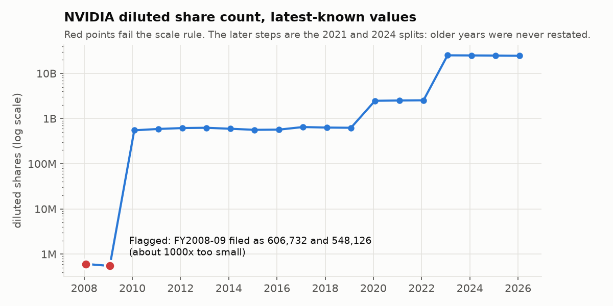
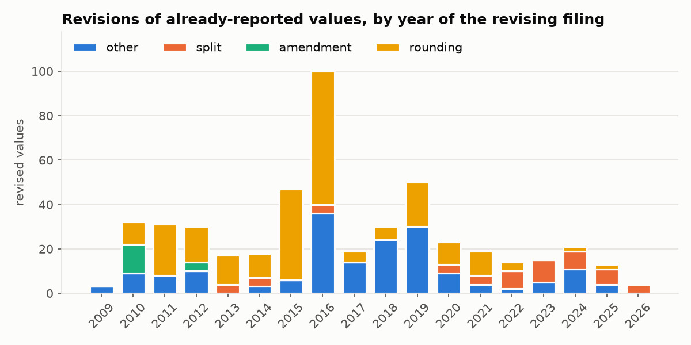
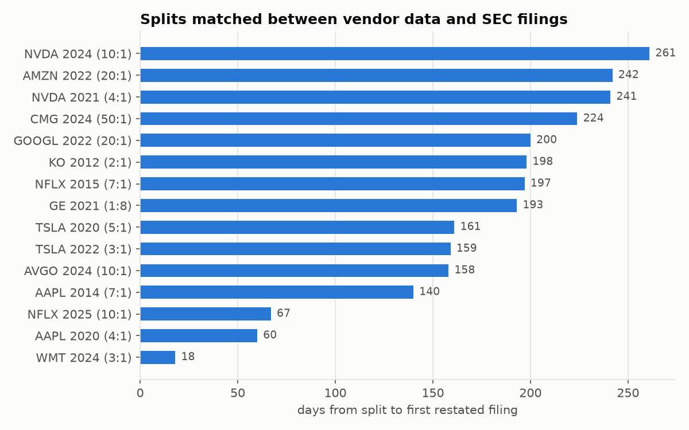
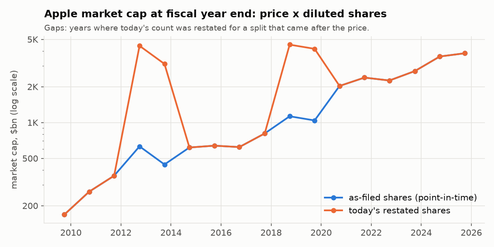
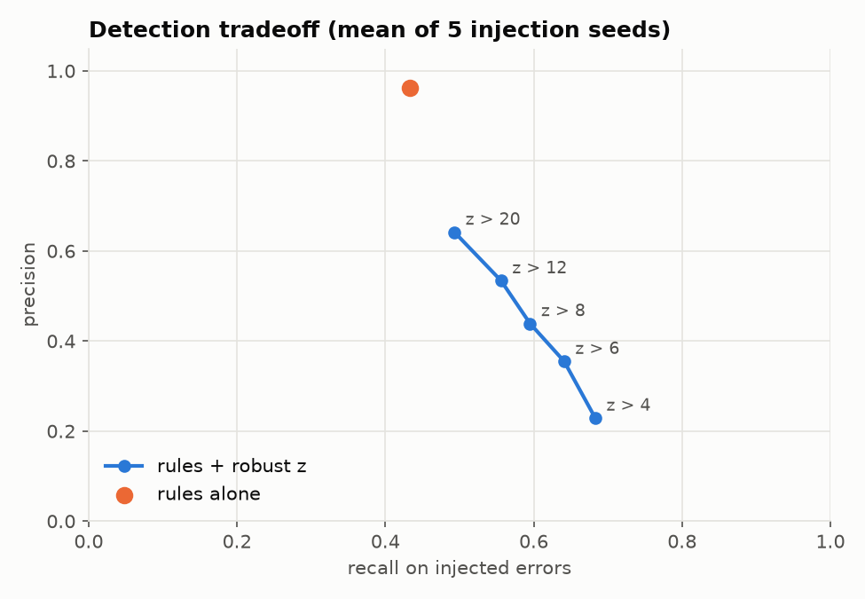

# Point-in-time fundamentals

Fundamentals from SEC XBRL `companyfacts` for 27 US large caps (including 3 later acquired: TWTR, ATVI, XLNX), stored bitemporally so every reported version of a value is kept. They are linked to a FIGI security master and to market prices, then checked with rules, a robust z-score and cross-dataset reconciliation.

- [`out/report.md`](out/report.md): full results
- [`DATA_PRODUCT.md`](DATA_PRODUCT.md): who uses this data, what they need, and the field dictionary with lineage

## Findings

### A 1000× scale error in SEC data
NVIDIA's diluted share count was filed in thousands for FY2008–FY2011 (10-Ks `0001045810-10-000006` and `0001045810-11-000015`). FY2010–11 were later corrected; FY2008–09 never were. Two independent checks catch it: the scale rule, and the market-cap continuity check against prices.



### Most "restatements" aren't
Of 486 revisions of already-reported values: 234 are rounding, 178 are reclassifications or recasts (e.g. XOM and KO revenue), 57 are split-driven and 17 are amendments.



### Filings vs vendor market data
- **Splits:** all 15 splits inferred from restated filings match a vendor split event. The restated figures first appeared 18–261 days after the split.
- **Spin-offs recorded as splits:** Yahoo records three GE spin-offs as "splits" (1.04, 1.281, 1.253). Share counts didn't change, so the filings correctly don't show them.
- **Delisted companies missing:** Yahoo has no data for the three delisted companies, so vendor-side survivorship bias is visible.
- **Two vendor splits with no filing match, both explained:** GOOGL 2014, because Google Inc. filed under a different CIK before Alphabet; and Visa 2015, because Visa reports EPS and share counts only per share class, which `companyfacts` omits.
- **Security master isn't point-in-time:** OpenFIGI now maps the XOM ticker to "ExxonMobil Holdings Corp". Exxon Mobil Corp (CIK 34088) filed a Form 25-NSE (removal from listing) on 2026-07-02, which appears to be a holding-company reorganisation, so a join by today's ticker crosses legal entities.



### Point-in-time matters for market cap
Market cap = traded price × diluted shares at fiscal year end. In 31 of 352 company-years, today's restated share count and the as-filed count give caps more than 15% apart:
- **29 are split-basis effects.** The restated count is on a later split basis than the price.
- **2 are NVIDIA's corrected scale error.**

Other cases this handles:
- **Partially restated years:** Apple FY2012 was restated for the 2014 split but never for the 2020 one.
- **Splits between year end and filing:** Walmart's FY2024 10-K was filed after its 2024 split, so even the as-filed number is post-split.



### Other checks
- **Accounting identity:** 4 breaches. For JPM 2009, a later filing revised Assets but not the matching total, so the latest-known snapshot doesn't balance.
- **Anomaly flags:** 30 of 236 on the real data come from share counts in years that were never restated after a split.

### Detection on injected errors
2% of values were corrupted, averaged over 5 seeds. Stale and drift errors are held out from the rules.

| method | precision | recall | drift recall | stale recall |
|---|---|---|---|---|
| rules | 96% | 43% | 0% | 0% |
| rules + robust z (z > 6) | 36% | 64% | 56% | 2% |



## Run

```
python -m venv .venv && .venv/bin/pip install pandas numpy tabulate matplotlib
export SEC_USER_AGENT="Your Name your@email"   # SEC asks for contact info
.venv/bin/python pit.py ingest                   # ~1-2 min: SEC, Yahoo, OpenFIGI -> facts.db
.venv/bin/python pit.py asof AAPL shares_diluted 2020-06-30
.venv/bin/python pit.py report                   # out/report.md, CSVs, out/charts/
.venv/bin/python pit.py selftest
```

## Data model

| table | key | links to | source |
|---|---|---|---|
| `company` | `cik` | | SEC |
| `security` | `figi` | `company.cik` | OpenFIGI |
| `filing` | `accn` | `company.cik` | SEC |
| `fact` | `(cik, field, end, accn)` | `filing.accn`, `company.cik` | SEC XBRL |
| `price` | `(figi, month)` | `security.figi` | Yahoo, monthly; `close_raw` has splits undone |
| `vendor_splits` | `(ticker, date)` | | Yahoo |

`fact` is bitemporal: `end` is the period a value describes, and `filed` is when it became known. An as-of query takes the latest filing per `(cik, field, end)` with `filed <= as_of`. For example, Microsoft's market cap using only what was known on 2020-01-01:

```sql
SELECT c.name, s.figi, f.end, g.form, g.filed, f.val * p.close_raw / 1e9 AS cap_bn
FROM fact f
JOIN filing g   ON g.accn = f.accn
JOIN company c  ON c.cik = f.cik
JOIN security s ON s.cik = f.cik
JOIN price p    ON p.figi = s.figi AND p.month = substr(f.end, 1, 7)
WHERE c.ticker = 'MSFT' AND f.field = 'shares_diluted' AND g.filed <= '2020-01-01'
ORDER BY f.end DESC, g.filed DESC;
```

Fields and XBRL tags are listed in [`DATA_PRODUCT.md`](DATA_PRODUCT.md#field-dictionary).

## Checks

- **Revisions:** a later filing reports a different value for an already-reported period. Each is classified as `split` (the ratio is a split ratio on a share or per-share field), `amendment` (a /A form), `rounding` (<0.5%) or `other`.
- **Rules:** Assets vs LiabilitiesAndStockholdersEquity (>0.5%); scale (>300× off the neighbouring periods); negative values in fields that can't be negative.
- **Anomaly:** a robust z-score of each value's relative gap to the median of its neighbouring periods.
- **Split reconciliation:** vendor split events are matched to splits inferred from filings, by the same ratio within 450 days.
- **Market cap:** traded price × as-filed shares, moved to the period-end split basis. A year-on-year share change of more than 25% that no vendor split explains is flagged.
- **Scorecard:** RED means an identity breach or a rule flag. AMBER means more than 3 unexplained anomaly flags per 100 values, more than 10 other or amended revisions, or an unexplained share jump.

## Known limitations

- Flows are annual only. 10-Q flows are year-to-date and Q4 isn't filed, so quarterly flows need derivation.
- "Known" means the day-level `filed` date, not `acceptanceDateTime`.
- The universe is hand-picked and still mostly survivors.
- The z-score uses future neighbours, so it is retrospective QA rather than a trading-time signal.
- Evaluation precision counts genuine anomalies already in the data (M&A, IPOs, buyback-driven negative equity) as false positives.
- `companyfacts` has no dimensional facts (per-class figures), and predecessor CIKs aren't linked.
- The security master maps by today's ticker. Yahoo's API is unofficial.
